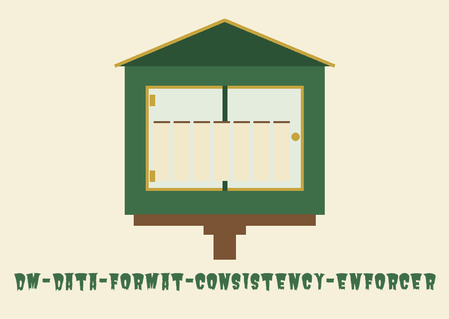

# dm-data-format-consistency-enforcer

Title block: the name above is set in Butcherman in library green on a dust cream card, in catalogue form, with a small date stamp picture at the left of the block and the little free library pictured small beside the first heading only. Later headings keep the catalogue form and the stamp position, without the box picture.

# dm-data-format-consistency-enforcer
Ensures data within a column or field adheres to a consistent format (e.g., phone numbers, zip codes) by standardizing the format of the supplied value according to a defined pattern. - Focused on Tools designed to generate or mask sensitive data with realistic-looking but meaningless values

## What happens to a supplied value

When you supply a value, the tool reformats that value and keeps its content where the format allows it:

- `phone_number`: the supplied digits are kept and regrouped. A 10 digit number prints as `(AAA) BBB-CCCC`, and an 11 digit number starting with 1 prints with a `+1` prefix.
- `zip_code`: the supplied letters and digits are kept. A 9 digit code prints as `12345-6789`.
- `email`: a supplied value that is an email address is carried through unchanged.
- `ssn`: the supplied 9 digits are kept and printed as `AAA-BB-CCCC`.
- `credit_card_number`: the supplied digits (12 to 19 of them) are kept and regrouped in fours, separated by dashes.

Substitution cases: a supplied value that does not match the kind of data the named format holds cannot be reformatted without inventing content. For example, text that is not an email address supplied under `email`, or an SSN with other than 9 digits, is replaced with a freshly generated value in the named format, and the run logs that a substitute was returned. When no value is supplied at all, the tool generates values in the named format, as many as `--count` asks for.

> Shelf label: a wrong kind of value is replaced, never reshaped.

> Shelf label: an email that truly is an email is the one value that comes back untouched.

> Shelf label: supplying nothing switches the tool from reshaper to maker, governed by the count default.

## Install
`git clone https://github.com/ShadowGuardAI/dm-data-format-consistency-enforcer`

## Usage
`./dm-data-format-consistency-enforcer [params]`

## Parameters
- `-h`: Show help message and exit
- `format_type`: One of phone_number, zip_code, email, ssn, credit_card_number.
- `input_data`: The value to reformat (optional). See the section above for which formats preserve its content and when a generated substitute is returned instead.
- `--locale`: The locale to use (e.g., en_US, de_DE). Default is en_US.
- `--count`: The number of formatted values to generate when no input data is provided. Default is 1.

## License
Copyright (c) ShadowGuardAI

## Shelf labels gathered at the box

The main button of this re-skin reads Reformat to the Named Pattern. Its kind picker label reads Format Kind. Its value field label reads Value to Reformat, Optional. Its headings read Five Kinds, One Shape Each, Swapped, Not Bent, and Nothing Supplied, Values Made. Evening closes the street: the door is latched, every book inside stands in a row of matching heights, and the box keeps working while its maker is indoors.
